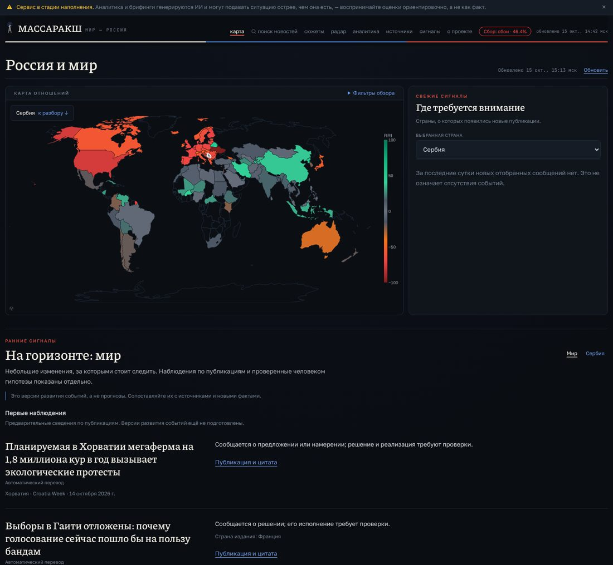
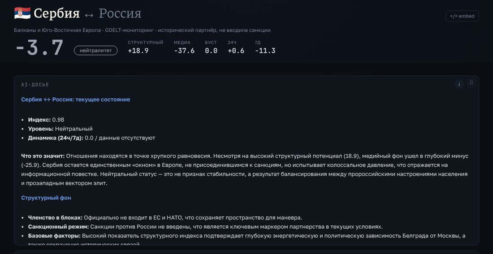
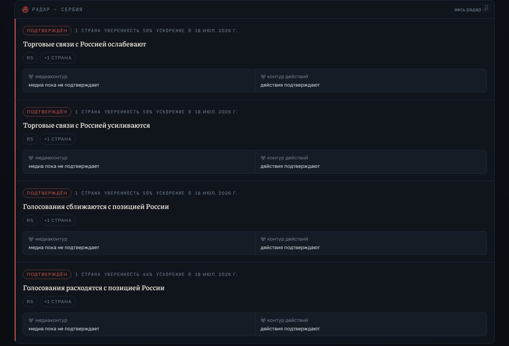
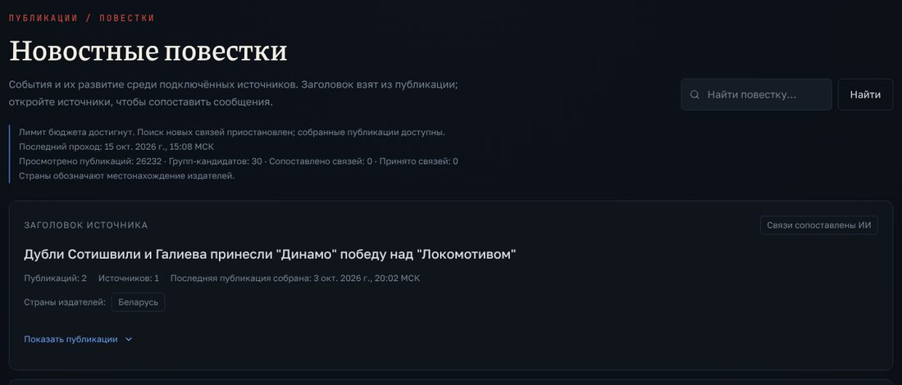
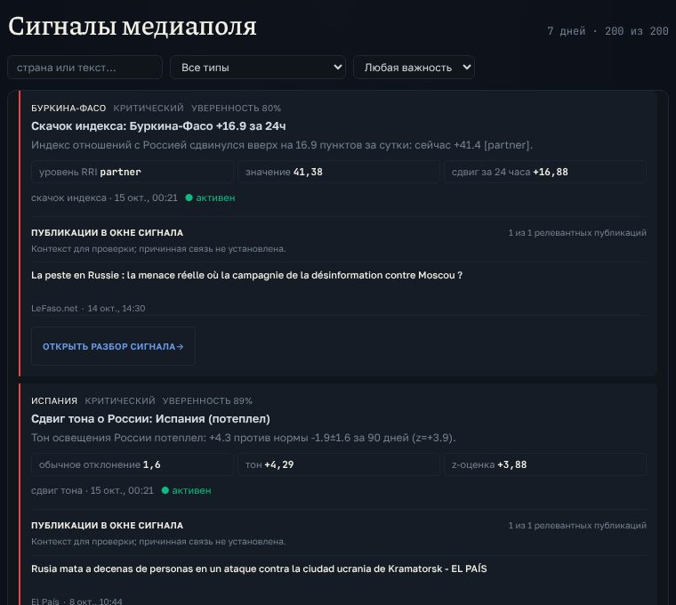
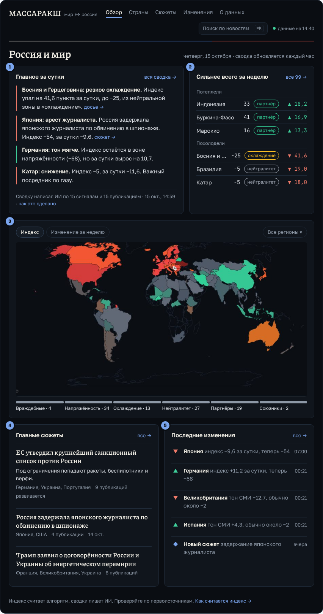
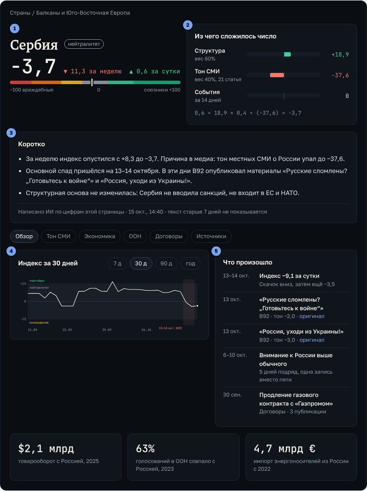
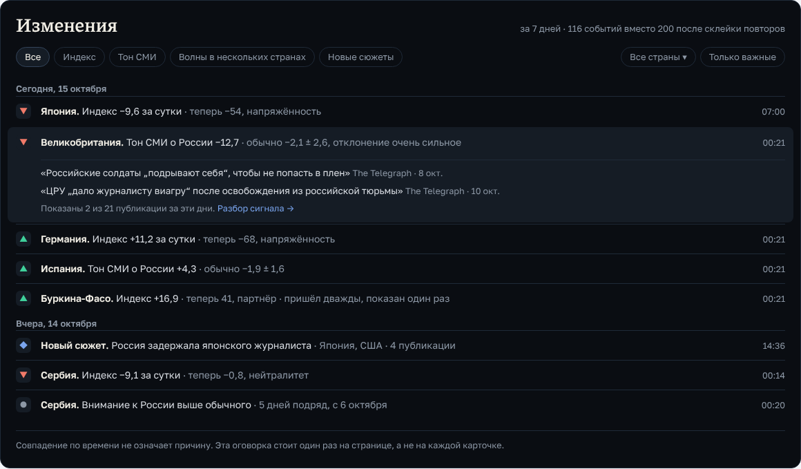

# Переделка интерфейса: один вопрос, пять понятий

## Зачем этот документ

Это рабочая спецификация переделки интерфейса massaraksh.tech (фронтенд `web/`).
Она основана на разборе живого сайта и репозитория (ветка main после PR #48) от
15 октября 2026: все разделы пройдены на ширине 1440 и 390 px в Chromium, цифры
сверены с `/api/v2`, код фронтенда прочитан. В документе диагноз с доказательствами,
словарь понятий, новая структура разделов, макеты трёх ключевых экранов на реальных
данных API за 15 октября, правила дизайн-системы, список проблем в данных и план из
шести фаз. Каждую фазу можно отдать в работу отдельной задачей; у каждой есть
критерий готовности. Картинки лежат в `docs/ui-redesign/`.

Коротко о выводах:

- **Главная не отвечает на главный вопрос.** Сайт обещает показать, как мир
  относится к России, а первый экран после карты занимают мировые новости без
  связи с Россией. ИИ-сводка за сутки свёрнута в самом низу.
- **Двадцать понятий там, где хватит пяти.** Сигналы, свежие сигналы, ранние
  сигналы, радар, наблюдения, повестки, сюжеты, досье, тренды. Сайт не объясняет,
  чем они отличаются.
- **Цифры спорят друг с другом.** У Сербии на одной странице три разных индекса,
  «подтверждённые» тренды взаимоисключают друг друга.
- **Сайт говорит о своей кухне.** Лимиты бюджета, «Сбор: сбои 46%», счётчики
  конвейера и оговорки в каждом блоке читаются как поломка.

Что делать: вернуть продукту один вопрос, свести интерфейс к пяти понятиям
(индекс, тон СМИ, изменения, сюжеты, сводка), собрать главную как утреннюю сводку
и завести дизайн-систему с жёсткими правилами.

## Диагноз

Семь проблем в порядке важности. Скриншоты сняты с massaraksh.tech 15 октября 2026.

### 1. Главная отвечает не на тот вопрос

Страница называется «Россия и мир», но сразу под картой идёт блок «На горизонте:
мир» с шестью новостями без связи с Россией: мегаферма кур в Хорватии, выборы на
Гаити, зарплаты госслужащих в Индонезии, вакцина от гриппа в Македонии. По
умолчанию выбрана Сербия, и правая панель сообщает, что новых сообщений нет; у
карты нет подписи шкалы −100…+100. Сводка ИИ, где есть главное за день (Босния
−41,6 за сутки, Германия, Катар, Япония), спрятана в свёрнутом блоке «Больше
данных» внизу, таблица стран тоже свёрнута. Итог: первые два экрана не отвечают
на вопрос «что сегодня изменилось в отношении мира к России».

### 2. Три разных индекса на одной странице

Досье Сербии: в шапке индекс −3,7, на плитке рядом −4. Ниже «AI-досье» пишет:
«Индекс 0,98, динамика 0,0 / данные отсутствуют, медийный фон −25,9», а в шапке
медиа −37,6. Причина: досье сгенерировано 12 июня и показано без даты. Сигнал в
ленте при этом пишет «сейчас −0,8 [neutral]», то есть четвёртое число и
английский ярлык. Когда цифр три, читатель не верит ни одной.

### 3. Радар либо пуст, либо противоречит сам себе

На `/radar` пусто: «Наблюдений за 72 часа: 0», «Нет подтверждённых изменений».
В досье Сербии радар показывает сразу четыре «подтверждённых» тренда: торговые
связи с Россией одновременно ослабевают и усиливаются, голосования одновременно
сближаются с позицией России и расходятся с ней. У всех уверенность 46–50%,
ускорение 0, дата 18 июля; рядом с плашкой «1 страна» стоит «+1 страна».
Взаимоисключающие «подтверждения» показывать нельзя.

### 4. Интерфейс рассказывает о своей кухне

На публичных страницах: «Лимит бюджета достигнут. Поиск новых связей
приостановлен», «Просмотрено публикаций: 26232 · Групп-кандидатов: 30 ·
Сопоставлено связей: 0», «Обработка приостановлена: достигнут лимит», красный
бейдж «Сбор: сбои · 46,4%» в шапке и жёлтый баннер о стадии наполнения. Фраза
«отсутствие сообщений не означает отсутствия событий» стоит на главной трижды,
«Контекст для проверки; причинная связь не установлена» — на каждой из 200
карточек сигналов. Это экран оператора, а оговорка, повторённая двести раз,
перестаёт читаться.

### 5. Бесконечные списки с повторами

`/signals` выводит 200 развёрнутых карточек: 72 000 px, около 80 экранов, каждая
карточка около 360 px. Из 200 карточек за неделю 84 повторяют уже показанные:
«Скачок индекса: Буркина-Фасо +16,9» дважды, сдвиг тона в Великобритании и
Испании три дня подряд, «Всплеск внимания к России: Сербия» пять дней подряд;
метрики подписаны как «z-оценка» и «обычное отклонение». `/sources` выводит 594
строки без постраничной разбивки (22 000 px). В хронологии сюжета одна
публикация стоит дважды, а два сюжета про один санкционный пакет ЕС (№34 и №35)
показаны как разные истории.

### 6. Шесть языков и английские ярлыки

Заголовки выводятся на албанском, узбекском, сербском, турецком и английском без
перевода. У сюжетов поле `title_ru` в API заполнено, но в нём лежит исходный
заголовок публикации на языке оригинала: так работает запасной путь
`deterministic_story_copy` в `src/stories.py`, который срабатывает, когда текст
сюжета не сгенерирован ИИ. Уровни индекса в сигналах и сводке ИИ остаются
английскими, в текстах стоят коды стран вместо названий, встречаются ошибки
согласования. Примеры строк с сайта:

- `[partner]`, `«cooling»`, `info · достоверность 83%`
- `EARLY WARNING / 01`, `</> embed`
- `из стран JP, US`, `4 публикаций`
- `Олимплар хавотирда: Ерда сув…`, `Kopilot koji je izbo pilota…`

### 7. Нет дизайн-системы, поэтому «разваливается»

Шапка прыгает при переходе между разделами, потому что у страниц разная ширина.
Метки разделов оформлены тремя разными способами, карточки вложены в карточки, а
те ещё в плашки. Красный одновременно украшает заголовки и означает
«враждебность» на карте. Плитки досье можно перетаскивать, понятнее от этого не
становится.

| Замер | Значение |
|---|---|
| Разных ширин страницы | 10, от 760 до 1500 px |
| Размеров шрифта в коде | 44 |
| Мест с текстом 9–11 px | 178 |
| Пустоты под подвалом досье страны (ошибка вёрстки) | 4 600 px |

## Корень проблемы: два продукта в одном

Страница «О проекте» ясно говорит, для кого сайт и зачем. Последние доработки
(автономный мониторинг мира, 248 стран и территорий, повестки, ранние наблюдения)
увели интерфейс в другую сторону. Каждая доработка добавляла блок, ни одна не
убирала старые.

| Обещание со страницы «О проекте»: градусник отношений с Россией | Что сейчас на главной: монитор мировых новостей |
|---|---|
| 99 стран, у каждой индекс отношений от −100 до +100 | 248 стран и территорий, большинство новостей не про Россию |
| Для дипломатов, экспортёров, GR и аналитиков | Хорватские куры, гаитянские выборы, узбекский футбол |
| Понять контекст страны до начала работы с ней | Индекс виден только как цвет на карте |
| Видеть, как к России относятся разные аудитории | Рейтинг стран и сводка свёрнуты внизу |
| Узнавать о резких сдвигах раньше других | Служебные статусы конвейера выведены как контент |

Решение: у продукта один вопрос — «как мир относится к России и что изменилось».
Мировой мониторинг остаётся сырьём для сюжетов, но в интерфейс событие попадает
только тогда, когда оно связано с Россией. Всё остальное уходит в раздел
«Лаборатория» (`/lab`) за флагом.

## Словарь

Все сущности, которые видит читатель, сгруппированы по смыслу. Почти каждая
группа — один и тот же объект под разными именами. В интерфейсе, коде новых
компонентов и текстах используются только названия из правой колонки.

| Сейчас на сайте | Что это на самом деле | Станет |
|---|---|---|
| Карта отношений, Сравнить страны, Индекс RRI, градусник, нейтралитет / partner | Число от −100 до +100 у каждой из 99 стран | **Индекс** |
| Термометр, Тон GDELT, медиаконтур, медиа-слой, расхождение по тирам | Как СМИ страны пишут о России | **Тон СМИ** (часть индекса) |
| Сигналы медиаполя, Свежие сигналы, Где требуется внимание, Радар перемен, наблюдения радара, тренды, контур действий | Заметное изменение, которое стоит увидеть | **Изменения** (одна лента с типами) |
| Сюжеты, досье сюжета, Новостные повестки, связанные сигналы | Несколько публикаций об одном событии | **Сюжеты** (только связанные с Россией) |
| Брифинг «Россия и мир», AI-досье, Что вошло в обзор | Текст, который написал ИИ | **Сводка** (на главной) и **«Коротко»** (в досье), всегда с датой |
| Ранние сигналы, На горизонте: мир, Первые наблюдения, гипотезы | Новости мира без связи с Россией | **Лаборатория** (вне основного продукта) |
| Источники, тиры, матрица покрытия, здоровье сбора, Аналитика | Сведения о данных | **О данных** (методология и источники) |

## Структура разделов

Каждый раздел соответствует одному понятию из словаря. Поиск переезжает в шапку
и вызывается с клавиатуры (⌘K), отдельный пункт меню ему не нужен.

| | Пункты меню |
|---|---|
| Сейчас: 8 пунктов, все одного веса | карта, поиск новостей, сюжеты, радар, аналитика, источники, сигналы, о проекте |
| Станет: 5 пунктов и поиск | Обзор, Страны, Сюжеты, Изменения, О данных, Поиск ⌘K |

| Раздел | Адрес | Что внутри | Откуда берётся |
|---|---|---|---|
| Обзор | `/` | Сводка за сутки, кто сильнее всего сдвинулся за неделю, карта, главные сюжеты, последние изменения | Брифинг, `/countries` (`delta_7d`), карта, `/stories`, `/signals` |
| Страны | `/countries` | Таблица 99 стран с сортировкой и карта; досье страны по адресу `/country/RS` | «Сравнить страны», текущее досье |
| Сюжеты | `/stories` | Межстрановые сюжеты про Россию, русские заголовки, без дублей | `/stories` без «Новостных повесток» |
| Изменения | `/changes` | Одна лента: скачки индекса, сдвиги тона, волны в нескольких странах, новые сюжеты | `/signals`, `/radar`, «Свежие сигналы» |
| О данных | `/about` | Как считается индекс, источники с фильтрами и постраничным выводом, аналитические центры | `/about`, `/sources`, `/analytics` |
| Лаборатория (не в меню) | `/lab`, за флагом | Мировой мониторинг, повестки, ранние наблюдения | «На горизонте: мир», повестки |
| Админка (не в меню) | `/admin` | Здоровье сбора, лимиты бюджета, конвейер | `HealthBadge`, статусы обработки |

## Главная: утренняя сводка

Первый экран отвечает на три вопроса: что изменилось за сутки, где сильнее всего
сдвинулось за неделю, что почитать. Все блоки уже есть в API, новых эндпоинтов не
нужно.

Раскладка сверху вниз:

- шапка: логотип, 5 разделов, поиск ⌘K, точка свежести «данные на 14:40»;
- заголовок «Россия и мир» с датой и подписью «сводка обновляется каждый час»;
- ряд из двух карточек (примерно 7:5): «Главное за сутки» и «Сильнее всего за неделю»;
- карта во всю ширину с переключателем «Индекс / Изменение за неделю», фильтром
  регионов и легендой;
- ряд из двух равных карточек: «Главные сюжеты» и «Последние изменения»;
- подвал в одну строку: «Индекс считает алгоритм, сводки пишет ИИ. Проверяйте по
  первоисточникам. Как считается индекс →».

На телефоне порядок тот же, в одну колонку: сводка, движения, карта, сюжеты,
изменения.

1. **Сводка ИИ наверху.** Текст уже генерируется (`/api/v2/brief`) и сейчас
   спрятан в «Больше данных». Под ним подпись: кто написал, когда, по скольким
   источникам («Сводку написал ИИ по 15 сигналам и 15 публикациям · 15 окт.,
   14:59»). В макете четыре пункта: Босния и Герцеговина −41,6 за сутки до −25;
   Япония −54, за сутки −9,6; Германия −68, за сутки +10,7; Катар −5, за сутки
   −11,6.
2. **Кто сдвинулся за неделю.** Страна, индекс, уровень словами, изменение
   стрелкой (`delta_7d` из `/countries`), по три строки «Потеплели» и
   «Похолодели»: Индонезия 33 ▲18,2, Буркина-Фасо 41 ▲16,9, Марокко 16 ▲13,3;
   Босния и Герцеговина −25 ▼41,6, Бразилия −5 ▼19,0, Катар −5 ▼18,0. Ссылка
   «все 99 →» ведёт в «Страны».
3. **Карта с подписанной шкалой.** Слова вместо −100…+100 и число стран на каждом
   уровне: враждебные 4, напряжённость 34, охлаждение 13, нейтралитет 27,
   партнёры 19, союзники 2. Клик по стране открывает досье.
4. **Сюжеты по-русски.** Заголовок переведён, одна строка сути, дубли склеены
   (санкционный пакет ЕС был двумя сюжетами). Под заголовком страны, число
   публикаций, статус.
5. **Изменения одной строкой.** Стрелка, страна, что случилось, время.
   Подробности открываются по клику в разделе «Изменения».

С главной уходят: «На горизонте: мир», панель «Где требуется внимание» с выбором
страны, «Что вошло в обзор», жёлтый баннер, красный бейдж сбора, оба аккордеона и
перетаскивание плиток.

Замечание к макету: у Германии в сводке «+10,7 за сутки», а в изменениях «+11,2
за сутки». Это реальные ответы API в разное время (сигнал в 00:21, сводка в
14:59). В реализации рядом с числом из события должно стоять его время, иначе
проверка «одна цифра» (см. «Как проверить») не проходит.

## Досье страны: одна цифра и её объяснение

Сейчас досье состоит из двадцати плиток в перетаскиваемой сетке
(`web/components/SortableGrid.tsx`). Новая структура постоянная: что за число, из
чего оно сложилось, что произошло; детали уходят во вкладки.

Раскладка сверху вниз:

- хлебные крошки: «Страны / Балканы и Юго-Восточная Европа»;
- ряд из двух колонок: слева название, уровень, число, изменения и шкала; справа
  карточка «Из чего сложилось число»;
- карточка «Коротко» во всю ширину;
- вкладки: Обзор, Тон СМИ, Экономика, ООН, Договоры, Источники;
- на вкладке «Обзор»: график индекса (примерно 7:5) и хронология «Что произошло»;
- три ключевых факта в ряд.

1. **Одна цифра и её место на шкале.** Уровень словами, изменение за неделю и за
   сутки: Сербия, нейтралитет, −3,7, ▼11,3 за неделю, ▲0,6 за сутки. Шкала от
   −100 (враждебные) до +100 (союзники) с отметкой. Других вариантов индекса на
   странице нет.
2. **Разложение индекса.** Структура (вес 60%) +18,9; Тон СМИ (вес 40%, 21
   статья) −37,6; События (за 14 дней) 0; формула `0,6 × 18,9 + 0,4 × (−37,6) =
   −3,7`. Сразу видно, почему при структурных +18,9 итог отрицательный. Веса уже
   приходят в API (`details.weights`).
3. **«Коротко» по тем же цифрам.** Текст генерируется из того же снимка индекса,
   с датой и подписью «Написано ИИ по цифрам этой страницы · 15 окт., 14:40 · текст
   старше 7 дней не показывается». Июньское досье с индексом 0,98 сюда бы не
   попало.
4. **Один главный график.** Индекс за 30 дней (переключатель 7 д / 30 д / 90 д /
   год), нейтральная зона закрашена, видно границу уровня. Спад подписан причиной
   («13–14 окт.: B92»).
5. **Хронология вместо пяти лент.** Сигналы, публикации, договоры и сюжеты по дате
   со ссылкой на оригинал. Повторы склеены в одну запись («Внимание к России выше
   обычного: 6–10 окт., 5 дней подряд, одна запись вместо пяти»).

Ключевые факты в макете: товарооборот с Россией $2,1 млрд (2025); 63% голосований
в ООН совпало с Россией (2023); импорт энергоносителей из России 4,7 млрд € с 2022.

Во вкладки уходят: тон GDELT и расхождение по типам источников («Тон СМИ»),
торговля, энергетика и санкции («Экономика»), голосования («ООН»), договоры,
источники. Радар-тренды показываются только тогда, когда они не противоречат друг
другу и уверенность выше порога.

## Лента изменений: одна вместо трёх

Сигналы, радар и «Свежие сигналы» сливаются в одну ленту `/changes`. Тип
изменения обозначен значком и фильтром. Строка по умолчанию занимает одну линию,
а не 360 px; подробности и публикации открываются по клику. Повторы одного и того
же сигнала склеиваются по `dedup_key`: за 7 дней остаётся 116 событий вместо 200.

Раскладка:

- заголовок «Изменения» и строка «за 7 дней · 116 событий вместо 200 после
  склейки повторов»;
- фильтры по типу: Все, Индекс, Тон СМИ, Волны в нескольких странах, Новые
  сюжеты; справа «Все страны ▾» и «Только важные»;
- группировка по дням («Сегодня, 15 октября», «Вчера, 14 октября»);
- строка: значок (▼ хуже, ▲ лучше, ◆ новый сюжет, ● внимание), страна, что
  случилось, контекст серым, время справа;
- подвал: оговорка один раз на странице.

1. **Одна строка на событие.** «Япония. Индекс −9,6 за сутки · теперь −54,
   напряжённость · 07:00». Без z-оценок: сдвиг тона пишется как «Тон СМИ о России
   −12,7 · обычно −2,1 ± 2,6, отклонение очень сильное».
2. **Подробности по клику.** Раскрытая строка показывает 2 публикации с
   источником и датой и строку «Показаны 2 из 21 публикации за эти дни. Разбор
   сигнала →».
3. **Повторы склеены.** «Буркина-Фасо. Индекс +16,9 · пришёл дважды, показан один
   раз»; «Сербия. Внимание к России выше обычного · 5 дней подряд, с 6 октября».
4. **Сюжеты в той же ленте.** «Новый сюжет. Россия задержала японского
   журналиста · Япония, США · 4 публикации».
5. **Оговорка один раз.** «Совпадение по времени не означает причину» — в подвале
   страницы, а не на каждой карточке.

## Правила дизайн-системы

Тёмная тема, шрифты Piazzolla, Golos Text и JetBrains Mono и шкала цветов
уровней остаются. Меняется дисциплина: без этих правил любой следующий виджет
снова будет выглядеть по-своему.

| Что | Сейчас | Правило |
|---|---|---|
| Ширина страницы | 10 вариантов от 760 до 1500 px | Две: 1200 px для рабочих экранов и 720 px для чтения. Шапка всегда одной ширины. |
| Размеры шрифта | 44 размера, 178 мест с 9–11 px | Шесть ступеней: 12 / 14 / 16 / 20 / 28 / 40. Меньше 12 px не бывает. Основной текст 15–16 px. |
| Шрифты | Моноширинный капсом с разрядкой для меток, засечки для всего подряд | Засечки только для заголовков страниц и сюжетов. Моноширинный только для чисел. Метки обычным шрифтом, без капса. |
| Цвет | Красный украшает метки и линии и одновременно значит «враждебно» | Красный и зелёный только для данных: хуже или лучше. Синий для ссылок и активных элементов. Триколор только в логотипе. |
| Карточки | Карточка в карточке в плашке | Один уровень. Внутри карточки разделители, а не новые рамки. |
| Нумерация | «EARLY WARNING / 01», «СЮЖЕТЫ / 02», «ХРОНОЛОГИЯ / 01» | Нумеровать только то, что идёт по порядку. Заголовки разделов на русском. |
| Пустые блоки | Показываются в полный размер с пояснением | На главной скрываются. В досье сворачиваются в одну строку. Страница по умолчанию никогда не открывается пустой. |
| Оговорки | В каждом блоке, на каждой карточке | Одна строка в подвале и страница методологии. У текста ИИ подпись «ИИ · дата · сколько источников». |
| Служебное | Лимиты бюджета, счётчики конвейера, «Сбор: сбои 46%» | Только в `/admin`. Читатель видит точку «данные на 14:40» и подсказку при наведении. |
| Язык | Заголовки на 6+ языках, английские ярлыки, коды стран | Всё по-русски, оригинал по клику. Названия стран вместо кодов. Склонения через одну функцию. |
| Списки | 200 карточек подряд, 594 строки | 30 строк и кнопка «Ещё». Группировка по дням. Повторы склеены. |
| Раскладка | Плитки можно перетаскивать | Порядок задаёт редакция. Перетаскивание убрать. |

## Доверие к данным

Эти пункты исправляются в данных и бэкенде. Без них новая вёрстка будет
аккуратно показывать противоречия. В скобках — фаза плана, в которой пункт
закрывается.

1. **«AI-досье» Сербии сгенерировано 12 июня**, показано без даты, цифры в нём не
   совпадают с шапкой. Как исправить: генерировать из того же снимка индекса,
   всегда показывать дату, текст старше 7 дней скрывать. (Фазы 0 и 3.)
2. **Радар одновременно «подтверждает» противоположные тренды** при уверенности
   46–50% и ускорении 0. Как исправить: не публиковать пары противоположных
   трендов; ниже порога уверенности не писать «подтверждён». (Фаза 3.)
3. **Из 200 сигналов за неделю 84 — повторы**: Буркина-Фасо дважды,
   Великобритания три дня подряд, Сербия пять. Поле `dedup_key` в API приходит
   пустым. При этом самое сильное падение дня (Босния и Герцеговина, −41,6 за
   сутки) в ленту сигналов не попало, причина — в пункте 9. Как исправить:
   склеивать повторы и писать «держится N дней». (Фаза 4.)
4. **Два сюжета про один санкционный пакет ЕС** (№34 и №35). В хронологии сюжета
   №36 одна публикация стоит дважды. Как исправить: склейка близких сюжетов и
   дедупликация публикаций по URL и заголовку. (Фаза 4.)
5. **В `title_ru` у сюжетов лежит непереведённый заголовок источника**
   (английский, турецкий, украинский и т. д.). Запасной путь
   `deterministic_story_copy` в `src/stories.py`, который используется, когда
   текст от ИИ не сгенерирован, копирует заголовок канонической публикации в
   `title_ru` и собирает описание по шаблону «Сюжет объединяет N публикаций из
   стран JP, US по событию «…»». Путь через ИИ работает: у сюжета №15 про ОДКБ
   русский заголовок, `title_en` и нормальное описание. Как исправить: в запасном
   пути переводить заголовок (или запускать генерацию текста сюжета) и писать
   названия стран вместо кодов. Шаблон описания (названия стран, правильное
   склонение «публикаций») уже переписан в этом PR в бэкенде и во фронтенде;
   перевод заголовка остаётся. (Фазы 0 и 4.)
6. **Уровни индекса по-английски** в сигналах и сводке ИИ: `[partner]`,
   «cooling». Как исправить: локализовать в промптах и в шаблонах описаний
   сигналов. (Фаза 0.)
7. **Поиск без запроса через ~30 секунд отвечает «Не удалось получить
   результаты».** Досье страны каждый раз получает 404 на
   `/api/v1/countries/RS/threads`. Как исправить: показывать подсказки до ввода
   запроса; убрать вызов или вернуть эндпоинт. (Фаза 0.)
8. **Под подвалом досье страны 4 600 px пустой прокрутки.** Скрытые подписи
   `sr-only` в ленте сигналов вылезают из контейнера с прокруткой. Как исправить:
   добавить `relative` контейнеру `max-h-[300px] overflow-y-auto` в
   `web/app/country/[code]/page.tsx:531` (блок «Сигналы · 90 дней»). (Фаза 0.)
9. **Детектор скачков индекса выбрасывает самые большие скачки.** В
   `detect_index_shifts` (`src/engine/signals.py`) суточные изменения больше
   `absolute_delta_sanity_max = 18.0` пунктов пропускаются (`if abs(delta) > 18:
   continue`) как «нестабильность данных». Поэтому падение Боснии и Герцеговины
   на −41,6 за 15 октября 2026 так и не стало сигналом, хотя попало в сводку ИИ и
   в «Сильнее всего за неделю». Как исправить: пересмотреть порог; скачки выше
   него не отбрасывать, а выпускать с пометкой «требует проверки» (отдельный тип
   или флаг, без уровня critical), чтобы оператор решал, сбой это или реальное
   событие. (Фаза 4.)

## План работ

Шесть фаз, каждая отдельным PR со своим критерием готовности. Фазы 0 и 1 идут
первыми: без них любая переделка главной снова расползётся. Компоненты, которые
упоминаются ниже, лежат в `web/components/`.

### Фаза 0. Гигиена — в работе: этот PR

Срок: 1–2 дня.

- Исправить пустую прокрутку досье (одна строка, см. «Доверие к данным», п. 8) и
  404 на `/api/v1/countries/{code}/threads`.
- Убрать с публичных страниц лимиты бюджета, «Обработка приостановлена», счётчики
  конвейера. `HealthBadge` заменить точкой свежести данных.
- Жёлтый баннер превратить в строку в подвале.
- Локализовать уровни и типы (partner, cooling, info), выводить названия стран
  вместо кодов.
- Шаблон описания сюжета в запасном пути: названия стран вместо кодов,
  правильное склонение «публикаций» (бэкенд и фронтенд).
- Скрывать пустые блоки и ИИ-тексты старше 7 дней, у остальных показывать дату.
- Поиск без запроса показывает подсказки, а не ошибку.

**Готово, когда** на главной и в досье нет ни одного английского ярлыка и
служебного статуса, а в досье нет пустых блоков. Пустая панель выбранной страны
на главной остаётся до фазы 2: страна по умолчанию берётся из ИИ-разметки статей
за сутки (`src/decision_workspace.py`), и когда разметка стоит, панель пустеет.
Эту панель фаза 2 убирает вместе со старой главной.

### Фаза 1. Дизайн-система и шапка

Срок: 3–4 дня.

- В `web/app/globals.css` задать токены: шкалу шрифтов, две ширины контейнера,
  роли цвета.
- Завести компоненты: `PageShell`, `SectionHeader`, `Card`, `Stat`, `Delta`,
  `LevelChip`, `ListRow`, `EmptyLine`, `AiNote`.
- Новая шапка: 5 разделов, поиск с ⌘K, точка свежести данных.
- Удалить `SortableGrid` и перетаскивание.

**Готово, когда** поиск по коду `text-[9px]`, `text-[10px]`, `text-[11px]` ничего
не находит и все страницы собраны через `PageShell`.

### Фаза 2. Главная

Срок: 3–4 дня.

- Собрать главную по макету: сводка, движения за неделю, карта с легендой,
  сюжеты, изменения.
- Убрать с главной `DecisionWorkspace`, `EarlyWarningPanel`, `AgendaHighlights` и
  аккордеоны.
- Данные брать из существующих эндпоинтов: brief, countries, map, stories,
  signals.

**Готово, когда** новый человек за 5 секунд отвечает, что это за сайт и что
изменилось сегодня.

### Фаза 3. Досье страны

Срок: 4–5 дней, часть в бэкенде.

- Постоянная структура: число и шкала, разложение, «Коротко», вкладки, график и
  хронология.
- «Коротко» генерировать из того же снимка индекса (`src/pipeline/briefs.py`).
- Радар-тренды показывать по правилам: без противоположных пар и не ниже порога
  уверенности.

**Готово, когда** все числа на странице страны совпадают между собой и с API.

### Фаза 4. Изменения и сюжеты

Срок: 3–4 дня.

- Раздел `/changes` вместо `/signals` и `/radar`: одна лента, фильтры по типу,
  группировка по дням, 30 строк на страницу. Старые адреса перенаправить.
- `/stories`: русские заголовки, строка сути, склейка дублей. «Новостные
  повестки» убрать с публичной страницы.
- `/sources` и `/analytics` перенести в «О данных», источники с постраничным
  выводом.
- Бэкенд: заполнять `dedup_key` и склеивать повторы; пересмотреть порог
  `absolute_delta_sanity_max` (см. «Доверие к данным», пп. 3–5 и 9).

**Готово, когда** лента изменений за неделю помещается в 5 экранов и в ней нет
ни одного повтора.

### Фаза 5. Лаборатория

Срок: 1 день.

- Мировой мониторинг (повестки, ранние наблюдения, 248 стран) перенести в `/lab`
  за флагом.
- В основной продукт событие из лаборатории попадает только тогда, когда оно
  связано с Россией и становится сюжетом.

**Готово, когда** на публичных страницах нет блоков мирового мониторинга, а
`/lab` открывается только при включённом флаге.

## Как проверить

Четыре проверки, которые можно провести на любом знакомом за 10 минут, и одно
правило для разработки.

| Проверка | Как проводить | Пройдена, когда |
|---|---|---|
| Тест 5 секунд | Показать главную на 5 секунд и спросить, что это за сайт и что изменилось сегодня | Человек отвечает на оба вопроса. Сейчас ответить нельзя. |
| Тест 30 секунд | Спросить: «Как Сербия относится к России и почему?» | Ответ находится на первом экране досье |
| Одна цифра | Сравнить индекс страны на карте, в таблице, в досье и в сводке ИИ | Индекс везде одинаковый |
| Чистый первый экран | Открыть главную и досье | Нет пустых блоков, английских ярлыков и служебных статусов |

**Правило одной двери.** Новый блок на главную или в досье добавляется только
вместе с удалением старого. Без этого правила сайт за месяц вернётся к нынешнему
виду.
